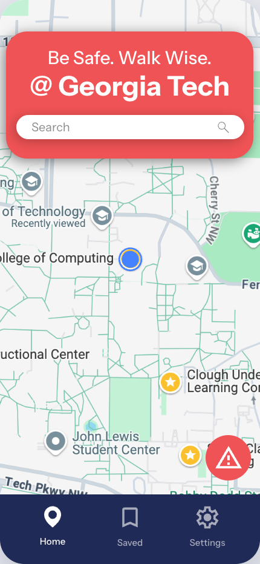
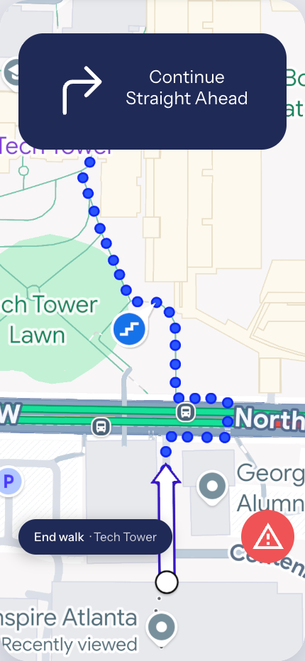
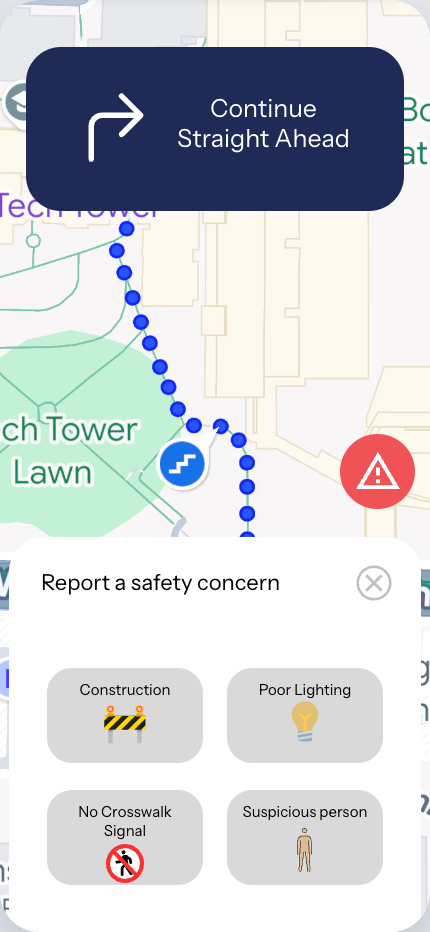

<p align="center">
  
</p>

<h1 align="center">WalkWise</h1>

<p align="center"><strong>Be Safe. Walk Wise.</strong><br />
A campus navigation app that puts student safety ahead of speed.</p>

---

Navigation apps like Google Maps are built to find the fastest route. When you're walking across campus late at night, the fastest route isn't always the best one.

WalkWise picks walking routes for safety. It favors well-lit paths, avoids hazards other students have reported, and adapts to what's happening on campus. It also lets students report concerns as they walk, so every walk makes the map safer for the next person.

This repository holds an interactive **mobile prototype** of the app and the WalkWise **design system**.

## Screenshots

<p align="center">
  
  
  
  
</p>

## What the prototype does

- **Splash:** the WalkWise logo, which moves on to Home automatically.
- **Home:** a campus map with your location. Search for a destination to start walking.
- **Navigation:** turn-by-turn walking directions shown over the route.
- **Report a safety concern:** the red ⚠ button is always within reach. You can report construction, poor lighting, a missing crosswalk signal, or a suspicious person.
- **Tab bar:** Home, Saved and Settings. Saved and Settings are placeholders for now.

> This is a design prototype. The maps are static images and the directions are sample data. No location, routing or reporting backend is connected yet.

## Getting started

You'll need [Node.js](https://nodejs.org/) 18 or newer.

```bash
npm install
npm run dev
```

Open the local URL that Vite prints. In a desktop browser the app appears inside a phone frame. On a phone it fills the screen.

| Command | What it does |
| --- | --- |
| `npm run dev` | Starts the dev server with hot reload |
| `npm run build` | Type-checks and builds the app for production into `dist/` |
| `npm run preview` | Serves the production build locally |

## Design system

The WalkWise visual language comes from the WalkWise Brand Identity guide:

| | |
| --- | --- |
| **Colors** | Navy Blue `#202A56` · Light Red `#F05355` · White `#FFFFFF` |
| **Typography** | Instrument Sans (Regular, Medium, Bold). Candara is used only in the logo. |
| **Mascot** | A friendly walking location pin inside a shield |

The design system appears in two places:

- **[`design-system/WalkWise-Design-System.html`](design-system/WalkWise-Design-System.html):** a standalone reference to the design system: logos, colors, type, spacing, components, guidelines, and tokens you can copy. Open it in any browser; it doesn't need the app.
- **[`src/design-system/`](src/design-system/):** the CSS tokens (`--ww-*`) and React components the prototype is built with. See its [README](src/design-system/README.md).

## Project structure

```
walkwise/
├── design-system/            Standalone design system reference (single HTML file)
├── docs/screenshots/         Images used in this README
├── public/
│   ├── assets/               Icons and map images from the Figma screens
│   └── brand/                Logos, app icon, mascot, footpath motif
└── src/
    ├── design-system/        Tokens, base styles and reusable UI components
    ├── components/           App-specific pieces (tab bar, report sheet, report button)
    ├── screens/              Splash, Home, Navigation, Saved/Settings placeholders
    ├── App.tsx               Screen flow and state
    └── styles.css            Screen layout
```

## Built with

- [React](https://react.dev/) 19 and [TypeScript](https://www.typescriptlang.org/)
- [Vite](https://vite.dev/)
- Plain CSS with custom properties (no CSS framework)
- Screens and brand designed in [Figma](https://www.figma.com/)

## Roadmap

Planned screens and flows:

- [ ] **Route preview:** compare the *Safest* and *Fastest* routes, with the reasons one is safer (lighting, blue-light phones, reports avoided)
- [ ] **SOS:** one tap to call campus police, see the nearest blue-light phone, and share your live location
- [ ] **Share my walk:** send your live location and arrival time to friends, with a check-in when you arrive
- [ ] **Smart rerouting:** get offered a safer route when a new concern is reported ahead
- [ ] **Safety map layers:** lighting, blue-light phones, recent reports, open buildings
- [ ] **Onboarding:** choose your campus, set up emergency contacts, set routing preferences
- [ ] Real **Saved** and **Settings** screens
- [ ] Live maps, routing and a reporting backend

## Author

Designed and built by Riya Ganguly.
